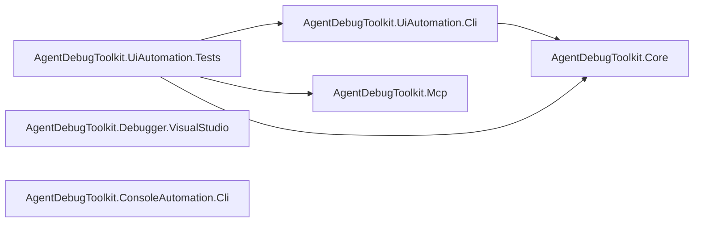

# Code Summary

AgentDebugToolkit is a Windows-only .NET 8 toolkit with independent UI Automation, Visual Studio
debugger, and ConPTY console CLI components, plus an MCP stdio server that exposes them. It
executes live operations while the calling agent owns navigation maps and workflow reasoning.

## Dependency Graph

## Symbol Index

### AgentDebugToolkit.Core

| Symbol | File | Responsibility |
|---|---|---|
| `JsonOutput` | `JsonOutput.cs` | Writes the shared success/error JSON envelope to stdout (see `docs/CLI_CONTRACT.md`) |
| `Selector` / `SelectorStrategy` | `Models/Selector.cs` | Describes how to locate a UI element (Name, AutomationId; NameRegex/ControlTypeIndex/Coordinates reserved for later phases) |
| `WindowInfo`, `ElementInfo`, `Rect` | `Models/WindowAndElementInfo.cs` | DTOs returned to the CLI caller describing windows/elements/bounding rects |

### AgentDebugToolkit.UiAutomation.Cli

| Symbol | File | Responsibility |
|---|---|---|
| `Program` / `Verbs` (top-level) | `Program.cs` | Parses args and dispatches UI Automation verbs; shared target/scope checks distinguish gone and hung HWNDs, and action-target resolution rejects ambiguous matches |
| `UiaHelper` | `UiaHelper.cs` | Enumerates windows through Win32; resolves selectors, virtualized grid cells/editors, and scroll targets; shares vertical scroll-search and ScrollPattern access; builds and filters `ElementInfo` trees while preserving ancestors; performs pattern-based or synthetic interaction |
| `SessionContext` | `SessionContext.cs` | Persists the "current" pid to a temp JSON file so subsequent CLI invocations (separate processes) can omit `--pid` after `attach` |
| `CursorSession` / `SystemCursorOperations` | `CursorSession.cs` | Share a cursor-indicator session with the script via a temp flag; reload, mark, and restore the arrow, hand, and I-beam through Win32 |
| `ScreenshotHelper` | `ScreenshotHelper.cs` | Saves element/window PNGs to local app data; window captures return the physical capture rectangle, image dimensions, and per-window DPI scale |
| `NativeMethods` | `NativeMethods.cs` | P/Invoke user32 helpers for Win32 window enumeration/metadata, synthetic mouse/keyboard input, and window queries; primary interaction mechanism since target apps often support no UIA patterns |

### AgentDebugToolkit.Debugger.VisualStudio

| Symbol | File | Responsibility |
|---|---|---|
| `Program` | `Program.cs` | EnvDTE debugger verb dispatch and JSON results |
| `DteLocator` / `ComRetry` | `DteLocator.cs`, `ComRetry.cs` | Finds a Visual Studio ROT instance and retries transient COM-busy calls |

### AgentDebugToolkit.ConsoleAutomation.Cli

| Symbol | File | Responsibility |
|---|---|---|
| `Program` / `ConsoleVerbs` | `Program.cs`, `ConsoleVerbs.cs` | Public launch, terminal, wait, status, and stop verb dispatch |
| `BrokerProgram` / `NativeConPty` | `BrokerProgram.cs`, `NativeConPty.cs` | Detached ConPTY broker, target lifecycle, pipe protocol, and Win32 interop |
| `TerminalBuffer` / `BrokerClient` | `TerminalBuffer.cs`, `BrokerClient.cs` | VT output buffer and named-pipe client transport |
| `ConsoleSessionContext` / `CommandLine` | `ConsoleSessionContext.cs`, `CommandLine.cs` | Persisted broker session validation and option parsing |

### AgentDebugToolkit.Mcp

| Symbol | File | Responsibility |
|---|---|---|
| `Program` | `Program.cs` | Starts the stdio MCP server and registers requested VS/UI/console tool groups; console is opt-in |
| `CliRunner` | `CliRunner.cs` | Launches existing CLI executables, relays JSON, and reports wrapper-level failures |
| `ArgumentFormatting` | `ArgumentFormatting.cs` | Shared option serialization for empty and `--`-prefixed values across all three MCP tool builders |
| `VsDebuggerTools` / `UiAutomationTools` / `ConsoleTools` | `VsDebuggerTools.cs`, `UiAutomationTools.cs`, `ConsoleTools.cs` | Exposes CLI verbs as MCP tools, including UIA-only absolute container scrolling; console launch is gated by an explicit executable allowlist |

See `docs/KEY_FLOWS.md` for traced end-to-end call flows.

## Other docs in this repo

`docs/ARCHITECTURE.md`, `docs/CLI_CONTRACT.md`, `docs/IMPLEMENTATION_PLAN.md`,
`docs/NAVIGATION_MAP_SCHEMA.md`, `docs/VALIDATION_FINDINGS.md` — pre-existing design/reference
docs, not owned by this memory-management skill.
